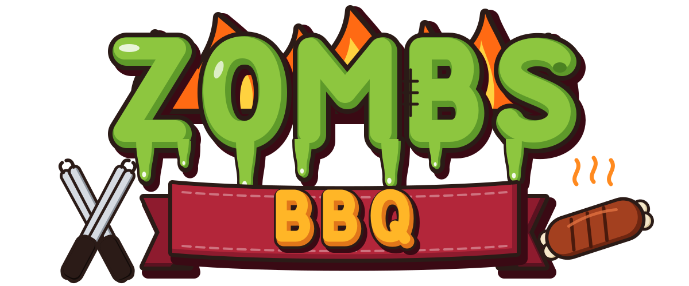
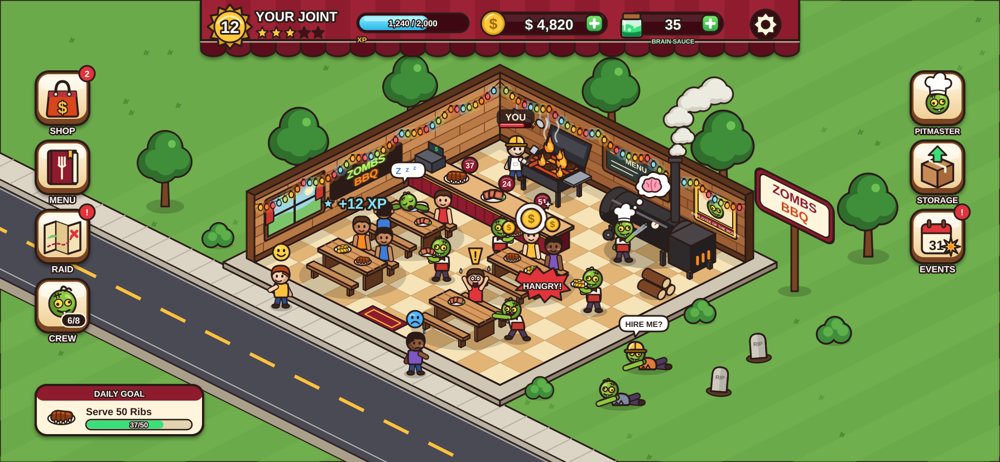
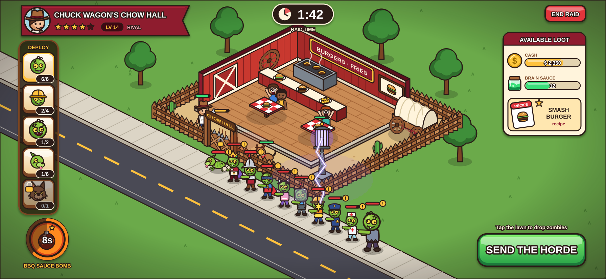
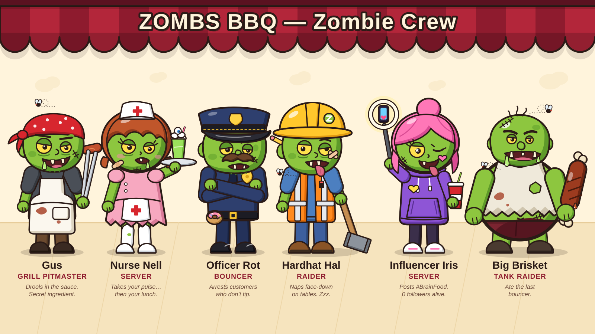
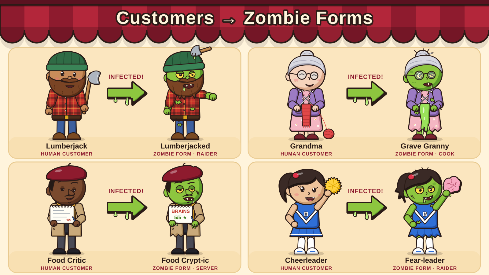
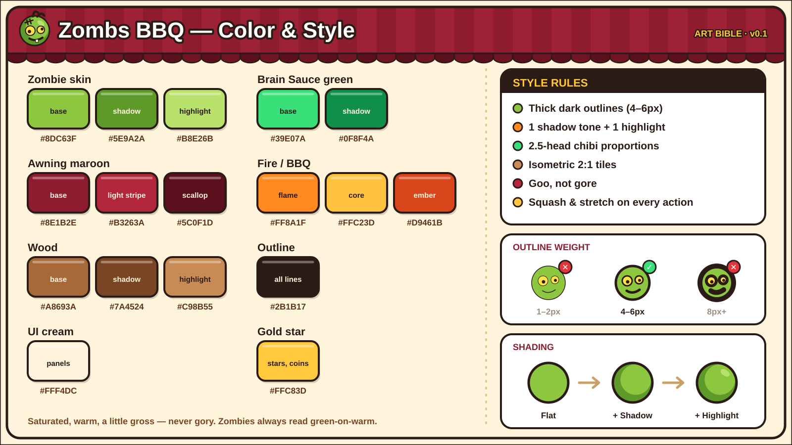
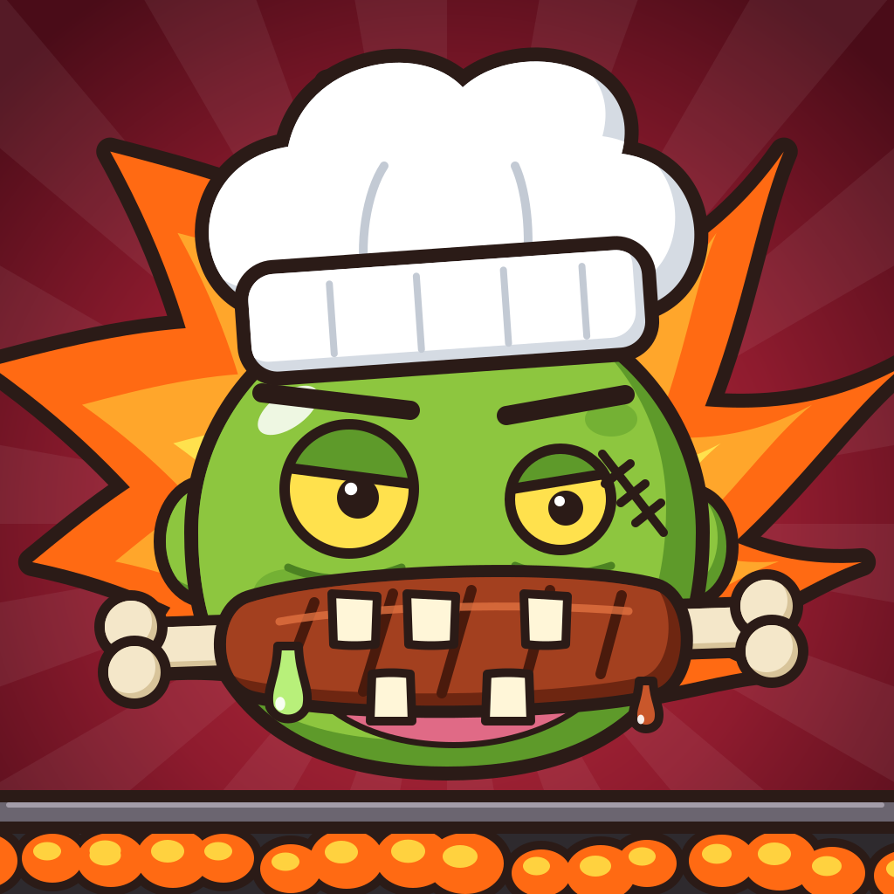

# 🧟🔥 Zombs BBQ

**The world ended, but the brisket didn't.**

Zombs BBQ is an iPhone restaurant sim and spiritual successor to *Zombie Café* (2011). You run a post-apocalypse BBQ smokehouse staffed entirely by zombies you infect from your own customers. Smoke ribs, keep your crew from snacking on the guests, decorate the joint into a legend, and raid rival restaurants for their secret recipes.



*Original IP. Not affiliated with Capcom or Beeline Interactive. No code or assets from Zombie Café are used.*

---

## 📍 Where we are

> **Status (2026-10-17): the core loop, interface and raids have been rebuilt to play like the original** (docs [21a](docs/21a-rebuild-core.md), [21b](docs/21b-rebuild-ui.md), [21c](docs/21c-rebuild-raids.md)), merged into `feat/fix-and-features`. 898 unit tests pass, typecheck is clean, and the full iPhone smoke test, the art gallery and the four-device fit check all pass with zero errors.

### Play it

| Where | Link | Notes |
|---|---|---|
| GitHub Pages | **https://qemmhd.github.io/ZombsBBQ/** | Serves the `gh-pages` branch (the split build: game, audio, icons). Switch it on once: repo **Settings → Pages → Deploy from a branch → `gh-pages` / root**. A private repo needs a paid GitHub plan for Pages. |
| Claude link | https://claude.ai/artifact/AceM4efaihGpTXtDs1MsDE | An older single-file build, private to the owner. |

Hold the phone sideways. Progress saves on the device.

### Branches

| Branch | What it is |
|---|---|
| `feat/fix-and-features` | **The main working branch.** Everything finished and merged, including the audio, animation and three rebuild branches. |
| `rebuild/core`, `rebuild/ui`, `rebuild/raids` | The three rebuilds, already merged into `feat/fix-and-features`. |
| `gh-pages` | The built game that GitHub Pages serves. |
| `claude/zombs-bbq-game-plan` | The older main branch, from before the restart notes. |
| `wip/tech-ios`, `wip/visual-fixes` | Older unfinished passes, not merged. |

### Known gaps
- **Sound:** 4 of 67 sounds are recorded; the rest use the built-in synth fallback. Higgsfield's sound-effect and music models are restricted to its own game pipeline, so the remaining sounds need generating elsewhere (prompts in `game/tools/audio/targets.json`, mastering spec in [doc 20](docs/20-audio.md)).
- **Raids:** zombies jam at the 1-tile door; floating damage numbers still pile up in big brawls; the sushi rival's sign reads "BIG HANK'S"; one win can bring home a very large loot stack (correct by the original's quarter-stack rule).
- **Not built yet:** the robot pets' combined form and pet-house café bonuses; chef avatar perks beyond the four stats.

---

## What's done

The game lives in [`game/`](game/). It's TypeScript, Phaser 4 and Vite, built web-first and to be wrapped for iOS with Capacitor later. The rules are a pure, deterministic sim with **898 unit tests**. There's also an end-to-end iPhone smoke test that plays every feature with real taps, an art gallery script and a device-fit check.

### Core café loop
- **Starting room:** you begin in a grimy corner lot at a crossroads. There are sidewalks and roads on both street sides, and you look at the room through a real front door that swings open as people walk through, with a tappable OPEN/CLOSED sign.
- **Grid and furniture:** all items take one tile. You get single-seat tables with separate chairs, a real expansion ladder, and you can paint individual walls and floor tiles.
- **Service:** customers walk the sidewalk, come in, need a *clean* table, think about a dish, wait (60 s), eat (30 s), pay and leave with a mood face. Dirty plates go to a sink or bin.
- **Cooking:** the cook has to stay at the stove (the dish pauses if they leave). A dish burns once it has waited as long as it took to cook, and finished dishes stack on counters.
- **YOU (Patient Zero):** you infect customers to grow your zombie crew. Each zombie has Energy and Patience, levels up, and has per-type perks.
- **Tired zombies:**
  - A hangry zombie slumps with a "!" for 5 s and is limited to one bite a minute; tapping Rest cancels the bite.
  - A zombie that runs out of energy passes out.
  - The "Eat!" command lets you feed one a customer on purpose.
  - Cooks only lose energy while prepping (the "simmer" rule).
- **Eating customers:** a zombie that catches someone eats them on the spot (a feast clip). The body drops and leaves a **bone pile** that lasts 10 s and fades over 3 s, like the original. Everyone else runs out screaming.
- **While you're away:**
  - Tired zombies nap instead of biting.
  - Stoves keep cooking for up to 24 h.
  - Closing for the night barely dents your stars.
  - Offline progress catches up the time you were gone.
- **Raising your rating:** a star rating, decor bonuses and **purple bonus stars**. Gus's 4-task to-do list (from level 6) earns them, and you can bribe the reviewer.

### Content
- **Dishes:** 60 in total, one new unlock per level up to 40.
- **Stations:** grill, smoker, fryer, Witch's Cauldron, Brick Pizza Kiln, Pit Oven and Tomb Smoker.
- **Rare variants:** Bulk, Quick, Spicy, Fancy, Frozen and Fresh, plus "Very" tiers. They come from raids and are unlocked in the fridge.
- **Customers:** 28 types, each with a zombie form, stats, a gag, perks and rarity.
- **Shop:** around 115 items, including money-makers, pets, tombstones, the Magic Fridge and stove upgrades.
- **Daily and long-term goals:** a Frequent Fryer daily streak, chef ranks, goals and a Zombiepedia.
- **Balance:** tuned with economy bots, so level 40 is reachable in about 3 months of play.

### Raids
- **The rivals:** real rival cafés (9×8 rooms) laid out like the original's.
  - The kitchen sits behind a divider and serving counter, with the chef at the stove.
  - Diners sit at tables, and new ones trickle in every 5–20 s.
  - Waiters patrol the floor.
- **The fight:**
  - Your squad lines up single file on the sidewalk.
  - Tap a zombie, then a target (or use ATTACK ALL).
  - Tombstones give 5 s buffs, and you can call in summons.
- **The road:** 9 rivals plus a boss food truck. Each rival scales to your level, and its toughness is capped.
- **After a raid:** you get loot, KO'd zombies reanimate, rivals reopen after 4, 8, 12 or 18 h, and a neglected rival starts stealing your customers. YOU stays home, like the original's chef.

### Art and animation (all drawn as code: SVG generated from TypeScript)
- **Look:** a gritty, adult-cartoon style with ink outlines and grime.
- **Characters:** a two-segment cut-out rig with the original's proportions (the head is about half the figure). Each character has full bodies, a back view and expression faces, with elbows and knees that stay seamless when they bend, chunky shoes and mitt hands.
- **Animations:** retuned to the original's decoded clips (walk, idle, sit, eat, carry, cook, serve, feast, attack, punch, hit, death).
- **Raid cast:** rival waiters and waitresses, head chefs with weapons, Big Foot-Long and Werewoof.

### Gus, alerts and saves
- **Gus's tips:** one-shot contextual tips, a guided first purchase, out-of-food and about-to-burn alerts, and "!" badges on HUD buttons.
- **Saves:** 3 rotating save slots with write verification. A corrupt save gets a recovery screen instead of being wiped, and a frame error can't freeze the game.
- **Rendering fix:** a build-time patch for a Phaser 4.2.1 shader bug that made half of rotated sprites vanish.

---

## Unfinished work on the WIP branches

### `wip/tech-ios` (4 commits, not merged)
- **Memory:**
  - lazy art building;
  - textures freed when off screen or after a raid;
  - decoded images dropped;
  - **old v2 art retired** (about a third of the source).
- **iOS and PWA:**
  - a manifest and drawn app icons;
  - gesture guards (no long-press image pop-ups, no pinch zoom);
  - a haptics wrapper;
  - debug hooks switched off in production.
- **CI:** a GitHub Actions workflow (`.github/workflows/pages.yml`) that tests, builds and publishes to `gh-pages` on every push.
- **A fix** to the embed build.
- **Not yet verified** with a full smoke run and memory re-measure.

### `wip/visual-fixes` (1 commit plus WIP, not merged)
- **Done (reviewed commit):** bundled OFL fonts, an original-style HUD (one icon row), camera framing so nothing hides under the awning, and crisp pooled floating text.
- **WIP commit:** part of a CSS pass (stars, XP bar, badge, chips, close button, infect card). It's unfinished and needs checking.
- **Not started:** the rest of [doc 12](docs/12-visual-audit.md).

---

## What's next (highest value first)

1. **Merge and verify the two WIP branches.** Then set up GitHub Pages auto-deploy (it's in `wip/tech-ios`).
2. **Visual audit** ([doc 12](docs/12-visual-audit.md)):
   - the raid text pile-up and the raid camera zoom;
   - hair on the back of heads;
   - a selection ring instead of the yellow tint;
   - a different look for each panel (notepad, cookbook, fridge);
   - sticker buttons;
   - stacked plates on the counter;
   - a ground and floor variety pass;
   - per-theme layouts for the rival cafés.
3. **Design audit leftovers** ([doc 13](docs/13-design-audit.md)):
   - "Sold out" rule;
   - decor as a floor under your rating;
   - Brain Sauce income;
   - raid odds meter and per-type raid abilities;
   - tombstones usable once per raid;
   - batch actions;
   - "close up for the night";
   - Gus and rival lines.
4. **Gameplay leftovers** ([doc 11](docs/11-gap-audit.md)):
   - sound bed (ambience, cooking loops, chewing, group scream);
   - acting clips (the arm-falls-off gag, celebrate, rise);
   - Meat Locker;
   - chef avatars;
   - more pets;
   - a Help page and Photo mode.
5. **Tech leftovers** ([doc 14](docs/14-tech-audit.md)):
   - texture atlasing;
   - baking the ground into one image;
   - a custom Phaser build;
   - accessibility (44-pt tap targets, aria);
   - CI lint;
   - a faster smoke test.
6. **The iPhone app:**
   - a Capacitor wrapper (the plan is in doc 14);
   - Haptics, Preferences, Splash and Status-bar plugins;
   - landscape lock;
   - a privacy manifest;
   - TestFlight. This needs a Mac and an Apple Developer account.

---

## Run it yourself

```bash
cd game
npm install
npm run dev        # play locally (Vite dev server)
npm test           # 1,319 unit tests (sim, art contracts, saves, raids, economy bots)
npm run typecheck  # TypeScript, the lint gate
npm run build      # dist/ plus the single-file dist/zombs-bbq.html
npm run smoke      # after a build: plays every feature as an iPhone with real taps (~15–20 min), screenshots in test-results/
npm run gallery    # after a build: a furnished joint plus every rival café mid-fight, in test-results/gallery/
node tests/devices.mjs  # after a build: HUD fit on iPhone 15 Pro Max, 15, 13 mini and SE
```

Dev tool: `npx vite` → `/tools/poses.html?c=joe&k=2&rows=walk,sit` shows a pose sheet with every animation frame by frame.

**Code map**
- `src/sim/`: pure game rules, deterministic and seeded. No Phaser or DOM imports.
- `src/art3/`: every sprite, generated as SVG.
- `src/scenes/`: Phaser rendering (the joint, raids, puppet animation).
- `src/ui/`: the DOM HUD.
- `src/game/controller.ts`: the glue between them.

## Docs

| Doc | What's inside |
|---|---|
| [01 — Research](docs/01-research.md) | How the original played, what fans loved, what to fix |
| [02 — Game Design](docs/02-game-design.md) | Pillars, loops, systems, economy, FTUE |
| [03 — Art & Animation](docs/03-art-and-animation.md) | Style rules, palette, UI, animation list |
| [04 — Tech Plan](docs/04-tech-plan.md) | Web-first TypeScript and Phaser, Capacitor for the App Store |
| [05 — Roadmap](docs/05-roadmap.md) | Phases from setup to App Store |
| [06 — Menus, Unlocks, Customers & Raids](docs/06-menus-unlocks-customers.md) | Every screen, the unlock tree, the roster and raid rules |
| [07 — Build Log](docs/07-build-log.md) | What was built in each version |
| [08 — Original Deep Dive](docs/08-original-deep-dive.md) | The original's look and play, the ranked gap list, lessons from its bugs |
| [09 — Art v3 Contract](docs/09-art-v3-contract.md) | Art frames, keys and the character rig contract |
| [10 — Original Animation & Layouts](docs/10-original-animation-and-layouts.md) | Decoded clip angles, timings, rival layouts and constants (facts only) |
| [11 — Gap Audit](docs/11-gap-audit.md) | About 40 gameplay gaps compared with the original |
| [12 — Visual Audit](docs/12-visual-audit.md) | 58 visual fixes |
| [13 — Design Audit](docs/13-design-audit.md) | Fun, pacing and balance, with economy-bot evidence |
| [14 — Tech Audit](docs/14-tech-audit.md) | Memory, crashes, boot time and the iOS/Capacitor plan |
| [15 — Bug Hunt](docs/15-bug-hunt.md) | Results of 145k simulated minutes of fuzzing (bugs since fixed on the main branch) |

**Licensing note:** the fan revival project studied for research has no license and contains Capcom's code and assets. Only facts (numbers, timings, layouts) were taken from it. None of its code, art or data is in this repo.

## Concept art

| | |
|---|---|
|  |  |
|  |  |
|  |  |
